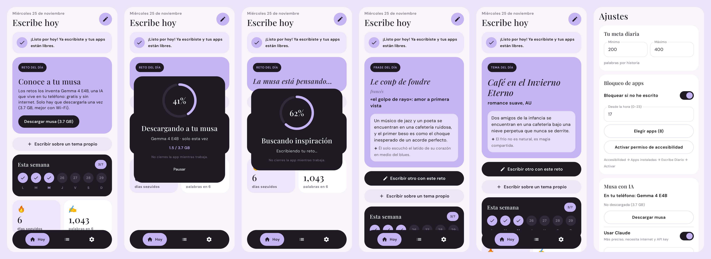

# Escribe Diario

App de Android para escribir un poquito cada día. Una IA que corre **en tu teléfono** te da un reto (una palabra de otro idioma, una frase o un tema) y escribes entre un mínimo y un máximo de palabras.



## Qué hace

- Reto del día al azar: palabra, frase o tema.
- Contador de palabras con anillo, mínimo y máximo.
- Historias con portada, historial y racha.
- Bloquea las apps que elijas a partir de cierta hora si no has escrito.

## IA

- **Gemma 4 E4B** (3.7 GB): rápida.
- **Gemma 4 12B** (6.9 GB): mejor calidad, más lenta.
- Se descargan desde la app (Ajustes → Musa con IA) y funcionan sin internet.
- Opcional: usar Claude con tu API key.

## Cómo correrla

1. Abre esta carpeta en Android Studio.
2. Conecta tu teléfono con depuración USB activada.
3. Dale a **Run**.

O desde la terminal:

```bash
./gradlew installDebug
```

Para el bloqueo de apps: Ajustes de Android → Accesibilidad → Escribe Diario → Activar.
